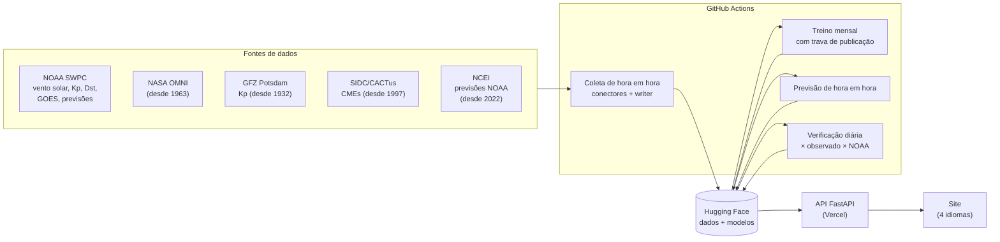

<!-- DOI badge -->

# Future Space: previsão experimental de tempestades geomagnéticas com IA

> English version (technical reference): [README.en.md](README.en.md)

| Recurso | Endereço |
|---|---|
| Site (PT, EN, ES, FR) | https://future-space-six.vercel.app |
| Documentação da API (OpenAPI) | https://future-space-six.vercel.app/docs |
| Dados e modelos | https://huggingface.co/datasets/Strutf/future-space |
| Código | https://github.com/Strutf/future-space |

## Resumo

Tempestades geomagnéticas afetam GPS, comunicações por rádio, satélites e redes elétricas, e
as previsões operacionais ainda erram bastante com algumas horas de antecedência. O Future
Space coleta de hora em hora dados abertos de clima espacial de seis provedores e os
padroniza num conjunto de dados público. Com eles, treina modelos de gradient boosting que
preveem os índices Kp (3 a 24 h à frente) e Dst (1 a 24 h à frente), com valor, probabilidade
de tempestade e alerta.

No período de teste (2019–2026), os modelos reduzem o erro (RMSE) em 13% a 25% em relação à
persistência. Num benchmark histórico contra a previsão oficial da NOAA SWPC (2022–2026, 2.528
emissões por horizonte), o erro médio do Kp foi 0,72 contra 1,16 a 6 h. As previsões ao vivo são
verificadas diariamente contra o observado e contra a NOAA.

## Autoria

**Victor Miranda Florido**

- Graduação em Ciência da Computação, Universidade Federal Fluminense (UFF)
- ORCID: [0009-0002-4580-2122](https://orcid.org/0009-0002-4580-2122)
- [Currículo Lattes](https://wwws.cnpq.br/cvlattesweb/PKG_MENU.menu?f_cod=C91310DFF650195584382DF3E5378A44#)
- GitHub: [Strutf](https://github.com/Strutf)

## Motivação e contexto

Uma tempestade solar começa no Sol: uma ejeção de massa coronal (CME), ou um feixe rápido de
vento solar, viaja até a Terra. Quando o campo magnético que ela traz aponta para o sul (Bz
negativo), ele se acopla ao campo da Terra, e a energia transferida perturba a magnetosfera.

Dois índices medem essa perturbação a partir de magnetômetros em solo:

| Índice | O que mede | Escala | Cadência | Tempestade |
|---|---|---|---|---|
| **Kp** | perturbação global do campo magnético, a partir de 13 observatórios de latitude média | 0 a 9 (em terços: 5−, 5, 5+…) | 3 h | Kp ≥ 5− (4,67), G1 na escala da NOAA; Kp 9 = G5 |
| **Dst** | intensidade da corrente de anel, a partir de observatórios próximos do equador | nT (negativo na tempestade) | 1 h | Dst ≤ −50 nT; abaixo de −250 nT, supertempestade |

O Dst representa melhor as latitudes baixas, como as do Brasil, e por isso o projeto prevê
os dois índices.

**Por que prever.** As tempestades geomagnéticas:

- degradam o posicionamento por GPS e as comunicações de rádio em HF;
- induzem correntes em linhas de transmissão (o apagão do Quebec em 1989);
- aumentam o arrasto sobre satélites em órbita baixa (a perda de satélites Starlink em fevereiro
  de 2022);
- expõem tripulações e voos polares à radiação.

O vento solar medido no ponto L1 dá cerca de 1 h de antecedência. Antecedências maiores
dependem de observar o Sol e de reconhecer padrões nos dados, que é o que o projeto investiga.

## Arquitetura

Nenhum servidor ou banco de dados roda continuamente. A coleta, a previsão e a verificação
rodam no GitHub Actions; os resultados ficam como arquivos (Parquet e JSON) num dataset do
Hugging Face; a API e o site rodam na Vercel e só leem esses arquivos. Todo o projeto usa
planos gratuitos.



| Parte | Onde fica no código |
|---|---|
| Coleta | `src/futurespace/pipeline/` (um conector por fonte em `connectors/`; `writer.py` mescla, remove duplicatas e grava) e `catalog.py` (metadados de cada dataset) |
| Modelo | `src/futurespace/ml/`: `features.py` (variáveis), `train.py` (treino e avaliação), `serve.py` (previsões ao vivo) |
| Verificação | `src/futurespace/ml/verify.py` (dia a dia) e `ml/evaluate.py` (tabelas de métricas) |
| API e site | `src/futurespace/api/` (`app.py`, páginas em `web/`) |
| Automação | `.github/workflows/`: `ingest.yml` (coleta, previsão e verificação), `train.yml` (treino mensal), `tests.yml` |

## Fontes de dados

Todas as fontes são públicas e gratuitas, e nenhuma exige cadastro. Toda tabela tem uma coluna
`time` em UTC.

| Dataset | Provedor | O que fornece | Cadência | Cobertura | Link |
|---|---|---|---|---|---|
| `omni-hourly` | NASA GSFC (OMNI2, via CDAWeb HAPI) | vento solar de várias sondas, intercalibrado e propagado até a Terra, mais Kp, Dst, AE e F10.7 | 1 h | 1963– | [OMNI2](https://cdaweb.gsfc.nasa.gov/hapi/info?id=OMNI2_H0_MRG1HR) |
| `kp-gfz` | GFZ Potsdam | Kp oficial (definitivo, preliminar ou nowcast) | 3 h | 1932– | [kp.gfz.de](https://kp.gfz.de/) |
| `cme-cactus` | SIDC (Observatório Real da Bélgica) | CMEs detectadas automaticamente nas imagens do coronógrafo LASCO: horário, direção, largura e velocidade | evento | 1997– | [CACTus](https://www.sidc.be/cactus/) |
| `kp-forecast-3day` | NOAA SWPC, arquivo da NCEI | todas as edições do 3-Day Forecast oficial (Kp previsto por bloco de 3 h) | 12 h | 2022– | [NCEI](https://www.ngdc.noaa.gov/stp/space-weather/swpc-products/daily_reports/3day_forecast/) |
| `solar-wind-plasma` | NOAA SWPC (RTSW) | velocidade, densidade e temperatura do vento solar no L1, por sonda | 1 min | desde a coleta | [rtsw_wind_1m](https://services.swpc.noaa.gov/json/rtsw/rtsw_wind_1m.json) |
| `solar-wind-mag` | NOAA SWPC (RTSW) | campo magnético interplanetário (Bt, Bx, By, Bz) no L1, por sonda | 1 min | desde a coleta | [rtsw_mag_1m](https://services.swpc.noaa.gov/json/rtsw/rtsw_mag_1m.json) |
| `kp` | NOAA SWPC | Kp planetário estimado | 3 h | desde a coleta | [planetary-k-index](https://services.swpc.noaa.gov/products/noaa-planetary-k-index.json) |
| `kp-forecast` | NOAA SWPC | cada previsão oficial de Kp emitida (para comparar com a do projeto) | 3 h | desde a coleta | [k-index-forecast](https://services.swpc.noaa.gov/products/noaa-planetary-k-index-forecast.json) |
| `dst` | WDC Kyoto (via NOAA SWPC) | Dst de tempo real (provisório) | 1 h | desde a coleta | [kyoto-dst](https://services.swpc.noaa.gov/products/kyoto-dst.json) |
| `goes-xray` | NOAA SWPC / GOES | fluxo de raios-X solar em duas bandas | 1 min | desde a coleta | [xrays-7-day](https://services.swpc.noaa.gov/json/goes/primary/xrays-7-day.json) |
| `goes-protons` | NOAA SWPC / GOES | fluxo integral de prótons (≥1 a ≥500 MeV) | 5 min | desde a coleta | [integral-protons](https://services.swpc.noaa.gov/json/goes/primary/integral-protons-7-day.json) |
| `goes-flares` | NOAA SWPC / GOES | lista de flares (início, pico, fim, classe) | evento | desde a coleta | [xray-flares](https://services.swpc.noaa.gov/json/goes/primary/xray-flares-7-day.json) |
| `solar-regions` | NOAA SWPC | regiões ativas, classes magnéticas e probabilidades oficiais de flare | 1 dia | desde a coleta | [solar_regions](https://services.swpc.noaa.gov/json/solar_regions.json) |
| `aurora-ovation` | NOAA SWPC (OVATION Prime) | probabilidade de aurora numa grade global de 1° (componente experimental) | 1 h | desde a coleta | [ovation](https://services.swpc.noaa.gov/json/ovation_aurora_latest.json) |
| `aurora-weather` | Open-Meteo | nuvens previstas nas cidades da previsão de aurora (componente experimental) | 1 h | desde a coleta | [open-meteo.com](https://open-meteo.com/) |

São 15 datasets coletados, de seis provedores (NOAA SWPC, NASA, GFZ, WDC Kyoto, SIDC e
Open-Meteo; a NCEI arquiva produtos da NOAA). Os modelos de Kp e Dst usam `omni-hourly`,
`kp-gfz` e `cme-cactus` no treino, e `solar-wind-*`, `kp`, `dst` e `cme-cactus` ao vivo. O
projeto também publica três datasets derivados: `predictions`, `verification` e
`aurora-visibility`.

Várias fontes de tempo real guardam só de 1 a 7 dias. O vento solar no L1, por exemplo, fica
cerca de 24 h na fonte, por isso a coleta é contínua.

## Metodologia do modelo

### Alvos

| Índice | Horizontes | Definição de tempestade |
|---|---|---|
| Kp | 3, 6, 12 e 24 h | Kp ≥ 5− (4,67) |
| Dst | 1, 3, 6, 12 e 24 h | Dst ≤ −50 nT |

Para cada índice e horizonte há dois modelos, num total de 9 pares:

- um **regressor**, que prevê o valor em *t + h*;
- um **classificador**, que dá a probabilidade de tempestade em *t + h*.

Para o Kp, o alvo é o bloco de 3 h que contém *t + h*.

### Tipo de modelo

Os modelos usam `HistGradientBoostingRegressor` e `HistGradientBoostingClassifier` do
scikit-learn (1.9.1, versão fixada). São conjuntos de árvores de decisão em que cada árvore
corrige o erro das anteriores. É aprendizado supervisionado treinado do zero nos dados do
projeto.

| Hiperparâmetro | Valor |
|---|---|
| taxa de aprendizado | 0,05 |
| máximo de folhas por árvore | 31 |
| mínimo de amostras por folha | 40 |
| regularização L2 | 1,0 |
| parada antecipada | desativada |
| semente aleatória | 0 (treino determinístico) |
| iterações do regressor | 200, 500 ou 1000, escolhidas pelo RMSE na validação |
| iterações do classificador | 400 |

A versão publicada, `v3-20261106`, tem 8.400 árvores e 512.400 nós no total.

### Variáveis

Só entram variáveis que também existem em tempo real. Assim, um modelo treinado no histórico
(OMNI) pode rodar com os dados coletados ao vivo. A versão 3 tem 82 variáveis em cinco grupos:

| Grupo | Variáveis |
|---|---|
| Vento solar no L1 (55) | Bz, By, \|B\|, velocidade, densidade, temperatura e pressão dinâmica; acoplamento de Newell `v^(4/3) B_T^(2/3) sin^(8/3)(θ/2)`; VBs = v·max(−Bz, 0); ângulo do relógio (sen, cos); para Bz, v, n, Newell e VBs, defasagens de 1 a 6 h e médias de 3 a 24 h; Bz mínimo em 3 a 12 h |
| Estado geomagnético atual (11) | Dst, defasagens, diferenças de 1 e 3 h e mínimo em 24 h; último bloco de Kp encerrado, o anterior e o máximo em 24 h |
| Recorrência de 27 dias (4) | velocidade e índices uma rotação solar antes, nas 24 h correspondentes |
| CMEs (8) | CME larga (≥ 90°) mais rápida em 24/48/72/96 h; número de CMEs largas em 72 h; estimativa balística da chegada |
| Calendário (4) | dia do ano e hora UT (sen, cos) |

Controles contra vazamento do futuro, verificados por testes automáticos:

- a linha da hora *t* usa só dados até o fim dessa hora;
- um Kp só é usado depois que o seu bloco de 3 h termina;
- uma CME só fica disponível 6 h depois do início, o atraso típico do catálogo de tempo real.

### Treino e janela de dados

1. **Divisão temporal, nunca aleatória:**
   - treino: 1995–2014;
   - validação: 2015–2018;
   - teste: 2019 em diante.
2. **Escolha na validação:** do número de iterações do regressor e do limiar de alerta.
3. **Avaliação:** os modelos são reajustados com treino + validação e avaliados uma única vez
   no teste.
4. **Modelo publicado:** é reajustado com **todos** os dados, de 1995 até o fim do OMNI
   disponível (30/10/2026 na `v3`), cerca de 31 anos. As métricas apresentadas continuam sendo
   as do passo 3.

O treino roda todo mês no GitHub Actions. Uma versão nova só é publicada se, no mesmo teste, o
RMSE médio não piorar mais de 2% e o BSS médio não cair mais de 0,02.

### Probabilidade de tempestade

- **Probabilidade:** é a saída do classificador (`predict_proba`), treinado com o rótulo
  binário "tempestade em *t + h*" pelas definições acima.
- **Alerta:** é emitido quando a probabilidade passa de um limiar escolhido na validação, entre
  0,02 e 0,90, aquele que **maximiza o HSS** (Heidke skill score). O HSS penaliza alarmes falsos
  em eventos raros. Os limiares da `v3` vão de 0,06 (Kp +24 h) a 0,42 (Dst +1 h).

Tempestades são raras: cerca de 2,3% das horas pelo Kp e 3,2% pelo Dst no período de teste. Por
isso, uma probabilidade de 20% já é muitas vezes a frequência normal.

## Avaliação

### Métricas usadas

Com acertos *a*, alarmes falsos *b*, perdas *c* e negativos corretos *d*:

| Métrica | Definição |
|---|---|
| MAE, RMSE | média de \|ŷ − y\| e √média(ŷ − y)² |
| POD (revocação) | a / (a + c) |
| FAR | b / (a + b); precisão = 1 − FAR |
| TSS | POD − b / (b + d) |
| HSS | 2(ad − bc) / [(a + c)(c + d) + (a + b)(b + d)] |
| Brier, BSS | média(p − o)²; 1 − Brier / Brier da climatologia |

A referência mínima é a **persistência**, "vai continuar igual": o Dst atual, ou o último
bloco de Kp encerrado.

### Teste histórico (2019-01-01 a 2026-10-30)

O teste usa a versão `v3-20261106` em 68.600 horas, com 2.174 horas de tempestade pelo Dst e
1.584 pelo Kp. O registro completo está em
[`/v1/models/v3-20261106`](https://future-space-six.vercel.app/v1/models/v3-20261106) e pode
ser reproduzido com `futurespace train`.

| Previsão | RMSE | RMSE persistência | Redução | POD | FAR | HSS | BSS |
|---|---|---|---|---|---|---|---|
| Dst +1 h | 3,82 | 4,40 | 13% | 0,93 | 0,12 | 0,90 | 0,85 |
| Dst +3 h | 7,48 | 8,88 | 16% | 0,83 | 0,29 | 0,76 | 0,67 |
| Dst +6 h | 10,53 | 12,58 | 16% | 0,72 | 0,37 | 0,66 | 0,53 |
| Dst +12 h | 14,08 | 16,79 | 16% | 0,50 | 0,50 | 0,48 | 0,33 |
| Dst +24 h | 16,76 | 20,59 | 19% | 0,41 | 0,73 | 0,30 | 0,16 |
| Kp +3 h | 0,76 | 1,01 | 25% | 0,60 | 0,54 | 0,51 | 0,36 |
| Kp +6 h | 0,91 | 1,17 | 23% | 0,58 | 0,72 | 0,36 | 0,22 |
| Kp +12 h | 1,04 | 1,34 | 22% | 0,41 | 0,83 | 0,21 | 0,08 |
| Kp +24 h | 1,15 | 1,50 | 23% | 0,31 | 0,90 | 0,12 | 0,04 |

O RMSE está em nT para o Dst e em unidades de Kp para o Kp. POD, FAR e HSS se referem ao
alerta.

- **Valor:** supera a persistência em todos os horizontes.
- **Alerta:** tem habilidade até cerca de 6 h. Em 12 a 24 h, a maioria dos alertas de Kp é
  falsa.

### Benchmark histórico contra a NOAA SWPC (2022–2026)

**Como é feito.** O `futurespace benchmark` usa o arquivo de todas as edições do 3-Day Forecast
da NOAA desde março de 2022 (NCEI), com emissões às 00:30 e às 12:30 UTC:

- **Modelo:** para cada edição, o modelo prevê com os dados disponíveis até a hora cheia
  anterior à emissão. É a versão treinada **só até 2018** (`futurespace train --no-refit`), que
  nunca viu o período comparado.
- **Comparação:** as duas previsões são confrontadas com o Kp definitivo do GFZ, nos mesmos
  blocos de 3 h e com a mesma antecedência.
- **Alertas:** o do modelo usa o limiar do classificador; o da NOAA conta quando o Kp previsto é
  ≥ 5−.

**Resultado:** 2.627 edições (03/2022 a 11/2026). Na comparação direta, são 2.528 emissões por
horizonte, de 03/2022 a 10/2026, limitadas pelo fim do OMNI disponível.

| Horizonte | Tempestades | MAE modelo | MAE NOAA | RMSE modelo | RMSE NOAA | POD modelo | POD NOAA | FAR modelo | FAR NOAA | HSS modelo | HSS NOAA |
|---|---|---|---|---|---|---|---|---|---|---|---|
| +6 h | 101 | **0,72** | 1,16 | **0,95** | 1,48 | **0,64** | 0,51 | **0,68** | 0,81 | **0,40** | 0,24 |
| +12 h | 74 | **0,80** | 1,18 | **1,05** | 1,51 | **0,47** | 0,42 | **0,84** | 0,87 | **0,21** | 0,16 |
| +24 h | 70 | **0,90** | 1,16 | **1,17** | 1,48 | **0,46** | 0,30 | 0,93 | **0,86** | 0,08 | **0,16** |

A NOAA sozinha, nas 55.122 previsões de bloco com Kp observado:

| Antecedência | n | MAE | RMSE | POD | FAR | HSS |
|---|---|---|---|---|---|---|
| 0–12 h | 10.508 | 1,16 | 1,49 | 0,41 | 0,82 | 0,21 |
| 12–24 h | 10.508 | 1,17 | 1,49 | 0,29 | 0,82 | 0,18 |
| 24–48 h | 21.006 | 1,15 | 1,47 | 0,21 | 0,84 | 0,15 |
| 48–72 h | 13.100 | 1,13 | 1,44 | 0,11 | 0,84 | 0,10 |

**Leitura:**

- **Valor do Kp:** o modelo erra menos que a NOAA nos três horizontes.
- **Alerta de tempestade:** o modelo é melhor em 6 h e 12 h; a NOAA, em 24 h. Os
  previsores da NOAA analisam imagens do Sol e a direção das CMEs, o que pesa mais nas
  antecedências maiores.
- **Ressalva:** a simulação usa o OMNI e o Kp definitivo, um pouco mais limpos que os dados de
  tempo real. A verificação diária, abaixo, testa se a vantagem se mantém na operação.

### Verificação diária contra a NOAA SWPC

**Como funciona.** O `futurespace verify` roda uma vez por dia (`ingest.yml`). Ele associa cada
previsão emitida ao valor observado depois e guarda, no dataset `verification`:

- o erro;
- a persistência no momento da emissão;
- para o Kp, a previsão da NOAA SWPC **emitida até o mesmo instante** para o mesmo bloco.

O comando `futurespace evaluate` calcula as métricas sobre todo o histórico salvo. Os números
abaixo saem dele, nos mesmos blocos para o modelo, a NOAA e a persistência.

O período verificado vai de 06/11/2026 21:00 a 10/11/2026 10:00 UTC: 684 previsões verificadas,
todas do modelo `v3-20261106`. **É uma amostra curta, de 4 dias,** e deve ser lida como
indicativa.

| Índice | Horizonte | n | MAE modelo | RMSE modelo | MAE NOAA | RMSE NOAA | MAE persistência | RMSE persistência |
|---|---|---|---|---|---|---|---|---|
| Dst | +1 h | 86 | 5,16 | 6,03 | — | — | 3,67 | 4,90 |
| Dst | +3 h | 84 | 5,11 | 6,77 | — | — | 7,04 | 8,72 |
| Dst | +6 h | 81 | 5,76 | 7,06 | — | — | 8,86 | 10,67 |
| Dst | +12 h | 75 | 6,31 | 7,82 | — | — | 9,32 | 11,39 |
| Dst | +24 h | 63 | 6,41 | 8,73 | — | — | 11,40 | 14,22 |
| Kp | +3 h | 81 | 0,47 | 0,61 | 0,93 | 1,19 | 0,63 | 0,80 |
| Kp | +6 h | 79 | 0,49 | 0,66 | 0,96 | 1,18 | 0,58 | 0,78 |
| Kp | +12 h | 73 | 0,58 | 0,83 | 0,80 | 0,97 | 0,74 | 0,96 |
| Kp | +24 h | 61 | 0,63 | 0,85 | 0,76 | 1,01 | 0,91 | 1,09 |

A NOAA não prevê o Dst.

Tempestades (Kp ≥ 5−, G1), nos mesmos blocos:

| Horizonte | Previsão | Tempestades observadas | Acertos | Alarmes falsos | Perdidas | Acurácia | Precisão | Revocação |
|---|---|---|---|---|---|---|---|---|
| +3 h | modelo (alerta) | 3 | 0 | 3 | 3 | 93% | 0% | 0% |
| +3 h | NOAA SWPC | 3 | 0 | 22 | 3 | 69% | 0% | 0% |
| +6 h | modelo (alerta) | 3 | 0 | 1 | 3 | 95% | 0% | 0% |
| +6 h | NOAA SWPC | 3 | 0 | 19 | 3 | 72% | 0% | 0% |
| +12 h | modelo (alerta) | 3 | 0 | 0 | 3 | 96% | — | 0% |
| +12 h | NOAA SWPC | 3 | 0 | 15 | 3 | 75% | 0% | 0% |
| +24 h | modelo (alerta) | 1 | 0 | 0 | 1 | 98% | — | 0% |
| +24 h | NOAA SWPC | 1 | 0 | 10 | 1 | 82% | 0% | 0% |

**Leitura:**

- **Kp:** no valor, o modelo teve erro menor que a NOAA e que a persistência em todos os
  horizontes.
- **Dst:** o modelo superou a persistência de +3 a +24 h, mas não em +1 h.
- **Tempestades:** houve 3 blocos de G1 no período, e nenhuma das previsões (modelo, NOAA ou
  persistência) acertou algum.
- **Acurácia:** é alta quase só porque "sem tempestade" é o caso comum, então precisão e
  revocação são as métricas que importam aqui.
- **Para concluir:** será preciso acumular meses de verificação, com mais tempestades. Para
  atualizar as tabelas, use `futurespace evaluate`.

## Como reproduzir

**Pré-requisitos:** Python 3.11 ou mais recente e git. Nada mais é necessário para coletar,
treinar e servir localmente. O Hugging Face, o GitHub Actions e a Vercel só são usados na
publicação.

```bash
git clone https://github.com/Strutf/future-space.git
cd future-space
python3 -m venv .venv && source .venv/bin/activate
pip install -e ".[dev,hf]"          # API, coleta, modelos e testes
cp .env.example .env                # opcional: só é preciso para usar o Hugging Face ou S3
```

**Variáveis de ambiente** (ver [`.env.example`](.env.example); todas são opcionais localmente):

| Variável | Finalidade | Padrão |
|---|---|---|
| `FS_STORAGE` | onde o pipeline grava: `local`, `hf` ou `s3` | `local` |
| `FS_DATA_DIR` | pasta para `local` | `data` |
| `FS_HF_REPO` | dataset no Hugging Face, ex.: `Strutf/future-space` | — |
| `HF_TOKEN` | token de escrita do Hugging Face (só para publicar) | — |
| `FS_DATA_URL` | URL alternativa de onde a API lê os JSON | — |
| `FS_RATE_LIMIT_PER_MINUTE` | requisições por minuto por IP na API (`0` desativa) | `60` |
| `FS_S3_BUCKET`, `FS_S3_ENDPOINT_URL`, `FS_S3_PREFIX` | configuração para `s3` | — |

**Coleta, treino, previsão, API e site:**

```bash
# 1. Coleta (grava em ./data)
futurespace backfill omni-hourly --start 1963-01-01   # histórico do OMNI (~4 min)
futurespace backfill kp-gfz --start 1932-01-01        # histórico do Kp (~30 s)
futurespace backfill cme-cactus --start 1997-01-01    # CMEs desde 1997 (~40 s)
futurespace update                                    # dados de tempo real (vento solar, Kp, Dst...)

# 2. Treino e avaliação no teste (~10 min; grava em ./models e imprime as métricas)
futurespace train --publish                           # --publish: usa os modelos nas previsões

# 3. Previsão com os dados atuais e verificação
futurespace predict
futurespace verify                                    # depois de algumas horas de previsões
futurespace evaluate                                  # tabelas de métricas em Markdown

# 4. Benchmark histórico contra a NOAA (2022–2026)
futurespace backfill kp-forecast-3day --start 2022-03-01   # edições da NOAA desde 2022 (NCEI)
futurespace train --no-refit --out models-2018             # modelo treinado só até 2018 (~10 min)
futurespace benchmark --bundle models-2018/bundle.joblib   # tabelas em Markdown

# 5. API e site em http://localhost:8000 (documentação em /docs)
futurespace serve --reload

# Testes e lint
pytest -q
ruff check src tests
```

Para avaliar só as previsões publicadas, sem coletar nada, leia direto do dataset público:

```bash
FS_HF_REPO=Strutf/future-space futurespace evaluate
```

**Reprodutibilidade dos modelos.** O treino é determinístico. Cada treino guarda num registro:

- o commit do código e a revisão dos dados no Hugging Face;
- os hiperparâmetros e as versões das bibliotecas;
- as métricas e a importância de cada grupo de variáveis.

Os registros ficam em [`/v1/models`](https://future-space-six.vercel.app/v1/models). A
`v3-20261106` é anterior a esse registro, e por isso não tem commit nem revisão.

## API

URL base: `https://future-space-six.vercel.app`. A documentação interativa fica em
[`/docs`](https://future-space-six.vercel.app/docs). O limite é de 60 requisições por minuto
por IP.

| Endpoint | Retorna |
|---|---|
| `GET /v1/datasets` | datasets e sua cobertura temporal |
| `GET /v1/datasets/{id}` | metadados, campos, unidades, licença e cobertura |
| `GET /v1/datasets/{id}/latest` | valores mais recentes |
| `GET /v1/datasets/{id}/data?start=&end=&fields=&format=json\|csv` | série temporal num intervalo |
| `GET /v1/datasets/predictions/latest` | previsões mais recentes do modelo |
| `GET /v1/compare/kp?date=AAAA-MM-DD` | Kp do modelo, da NOAA e observado, por bloco de 3 h |
| `GET /v1/compare/dst?date=AAAA-MM-DD` | Dst previsto e observado, por hora |
| `GET /v1/verification/summary` | erros das previsões nos últimos 7 e 30 dias |
| `GET /v1/models`, `GET /v1/models/{id}` | histórico e registro completo de cada treino |

Exemplo, previsões mais recentes de Kp:

```bash
curl https://future-space-six.vercel.app/v1/datasets/predictions/latest
```

```json
{
  "dataset": "predictions",
  "updated_at": "2026-11-10T19:23:58Z",
  "data": [
    {
      "time": "2026-11-10T19:00:00Z",
      "target": "kp",
      "horizon_hours": 3,
      "target_time": "2026-11-10T21:00:00Z",
      "value": 1.61,
      "storm_probability": 0.0004,
      "storm_alert": false,
      "model_version": "v3-20261106"
    }
  ]
}
```

A resposta foi resumida: ela traz os 9 pares (Kp e Dst em todos os horizontes).

Exemplo, Kp oficial durante a supertempestade de maio de 2024:

```bash
curl "https://future-space-six.vercel.app/v1/datasets/kp-gfz/data?start=2024-05-10T12:00Z&end=2024-05-11T00:00Z&fields=kp"
```

```json
{
  "dataset": "kp-gfz",
  "start": "2024-05-10T12:00:00Z",
  "end": "2024-05-11T00:00:00Z",
  "count": 5,
  "fields": ["time", "kp"],
  "data": [
    {"time": "2024-05-10T12:00:00Z", "kp": 3.667},
    {"time": "2024-05-10T15:00:00Z", "kp": 7.667},
    {"time": "2024-05-10T18:00:00Z", "kp": 8.667}
  ]
}
```

A resposta foi resumida.

## Limitações

- **Uso:** as previsões são **experimentais**. Para decisões reais, use a
  [NOAA SWPC](https://www.swpc.noaa.gov/).
- **Início das tempestades:** é difícil de prever. O modelo vê principalmente o vento solar no
  L1, cerca de 1 h antes de ele chegar à Terra, e as variáveis de CME não incluem a direção da
  ejeção.
- **Eventos extremos:** são subestimados, porque conjuntos de árvores não extrapolam além da
  faixa vista no treino (por exemplo, o Dst de −406 nT de maio de 2024).
- **Treino × operação:**
  - o treino usa o OMNI, propagado até a frente de choque, enquanto a operação usa a medida
    bruta no L1, cerca de 45 min antes;
  - o Dst de tempo real é provisório.
- **Verificação ao vivo:** ainda é curta (desde 06/11/2026), com poucas tempestades.
- **Visibilidade da aurora:** existe uma previsão por cidade (`aurora-visibility`), que é
  experimental e ainda não foi calibrada no backend. A pesquisa de calibração com câmeras
  all-sky está em [`research/aurora/`](research/aurora/).

## Como citar

**ABNT:**

> FLORIDO, V. M. **Future Space: previsão experimental de tempestades geomagnéticas com IA**.
> Versão 1.0.0. [S. l.]: Zenodo, 2026. Software. DOI: [a preencher]. Disponível em:
> https://github.com/Strutf/future-space. Acesso em: [data].

**BibTeX** (gerado a partir do [`CITATION.cff`](CITATION.cff)):

```bibtex
@software{florido_future_space_2026,
  author    = {Florido, Victor Miranda},
  title     = {Future Space: previsão experimental de tempestades geomagnéticas com IA},
  year      = {2026},
  month     = {11},
  version   = {1.0.0},
  publisher = {Zenodo},
  doi       = {DOI_A_PREENCHER},
  url       = {https://github.com/Strutf/future-space}
}
```

Ao usar os dados, cite também as fontes originais:

- **OMNI:** King & Papitashvili (2005), doi:10.1029/2004JA010649.
- **Kp:** Matzka et al. (2021), doi:10.1029/2020SW002641; dados em doi:10.5880/Kp.0001.
- **Dst:** WDC for Geomagnetism, Kyoto, doi:10.17593/14515-74000.
- **CACTus:** Robbrecht & Berghmans (2004), doi:10.1051/0004-6361:20041302.
- **Acoplamento de Newell:** Newell et al. (2007), doi:10.1029/2006JA012015.
- **scikit-learn:** Pedregosa et al. (2011), *JMLR* 12.

## Licença

O código é distribuído sob a licença [MIT](LICENSE). Os dados mantêm a licença de cada fonte,
indicada no catálogo da API (`/v1/datasets/{id}`):

| Fonte | Licença ou termos |
|---|---|
| NOAA SWPC e NCEI | domínio público |
| NASA OMNI | domínio público, com citação |
| GFZ (Kp) | CC BY 4.0 |
| WDC Kyoto (Dst) | uso científico com citação |
| SIDC/CACTus | uso livre com citação |
| Open-Meteo | CC BY 4.0, uso não comercial |
